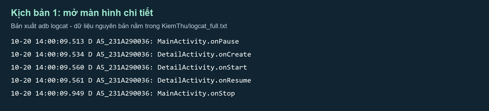
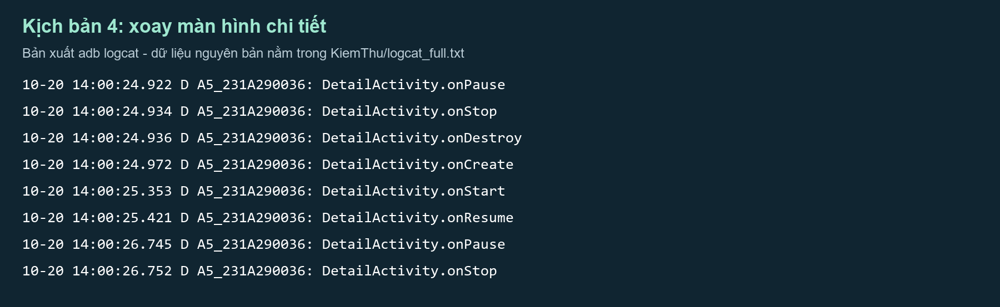
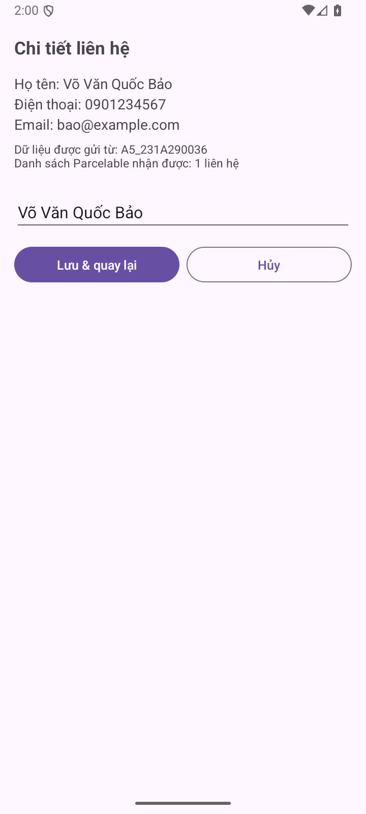
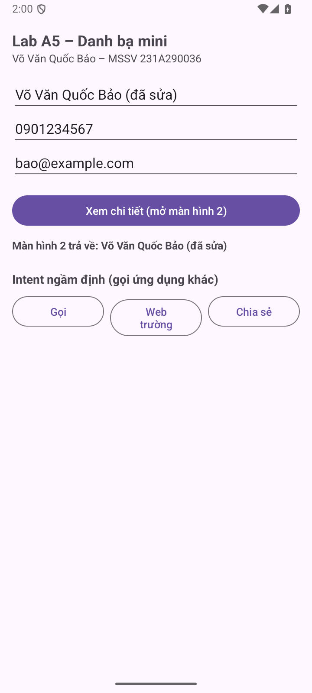
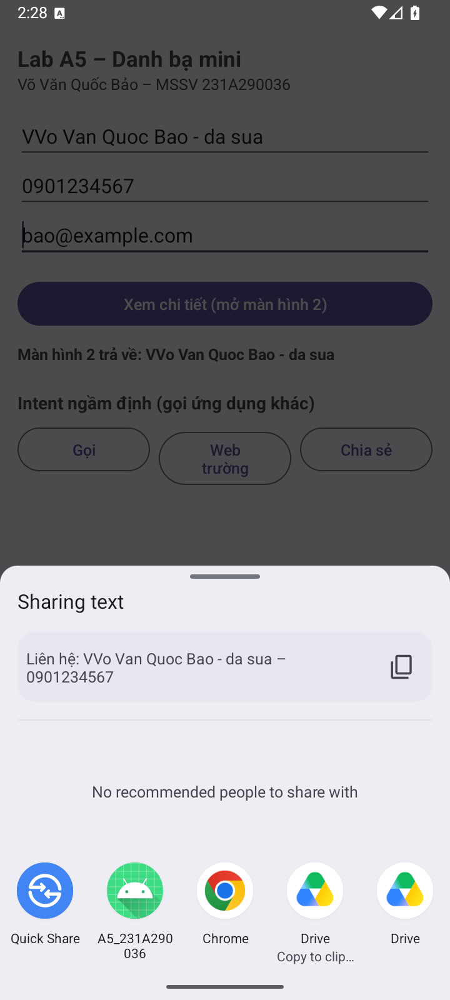
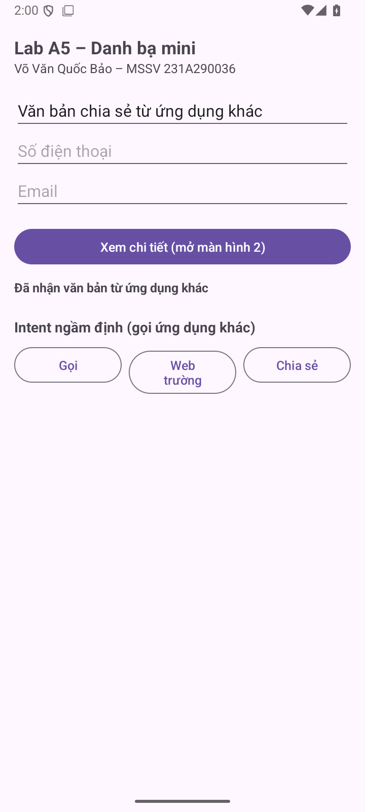

# BÁO CÁO LAB A5 - Chuyển màn hình và truyền dữ liệu bằng Intent
Họ tên: Võ Văn Quốc Bảo  |  MSSV: 231A290036

Học phần: INT4211 - Lập trình trên các thiết bị di động. Ngày kiểm chứng: 20/10/2026.

Repository: https://github.com/VOVANQUOCBAO/A5_231A290036

## 1. Thiết kế ứng dụng

Danh bạ mini có MainActivity và DetailActivity; Contact implements Parcelable với thứ tự đọc/ghi họ tên, điện thoại, email thống nhất. Bundle truyền Contact và mã người gửi. Activity Result API nhận RESULT_OK hoặc RESULT_CANCELED, luôn kiểm tra dữ liệu null.

Ba Intent ngầm định: ACTION_DIAL, ACTION_VIEW với trang trường và ACTION_SEND text/plain qua chooser. startActivity được bọc ActivityNotFoundException. Không thực hiện cuộc gọi trực tiếp, không cần quyền CALL_PHONE.

## 2. Bảng 5 kịch bản vòng đời

| # | Thao tác | Quan sát thật |
| --- | --- | --- |
| 1 | Bấm Xem chi tiết | Main.onPause → Detail.onCreate/onStart/onResume → Main.onStop. Thông tin và mã người gửi đúng. |
| 2 | Lưu và quay lại | Detail trả RESULT_OK (-1); Main nhận tên đã sửa trước onResume; Detail onStop/onDestroy. |
| 3 | Nhấn Back từ Detail | Main nhận RESULT_CANCELED (0); không thay tên đã lưu; hiện thông báo hủy. |
| 4 | Xoay khi đang ở Detail | Detail onPause/onStop/onDestroy rồi tạo lại; Intent còn dữ liệu; bản nháp chưa lưu giữ nguyên. |
| 5 | Chia sẻ rồi quay lại | Chooser hiện; Main bị pause và resume khi trở lại; điện thoại trên form giữ nguyên. |

Tên callback trong bảng được rút gọn để dễ đọc; log gốc ghi đầy đủ MainActivity và DetailActivity trong KiemThu/logcat_full.txt.

---

## 3. Minh chứng Logcat

Hai ảnh dưới là bản trình bày của dữ liệu xuất từ adb logcat, lọc tag A5_231A290036. Dấu thời gian và nội dung callback được giữ lại; tệp log nguyên bản được nộp kèm.

---

## 4. Ảnh ứng dụng và phần nâng cao

NC2: putParcelableArrayListExtra gửi danh sách Contact; Detail đọc bằng IntentCompat.getParcelableArrayListExtra và hiển thị số phần tử. NC4: Manifest nhận ACTION_SEND / text/plain; Main đọc EXTRA_TEXT, xử lý cả Intent khởi tạo và onNewIntent.

---

## 5. Trả lời 4 câu hỏi phân tích

1. Vì sao Main.onStop sau Detail.onResume?

Main chỉ cần dừng hẳn sau khi màn hình mới đã hiển thị; hệ thống pause Main, khởi tạo/resume Detail rồi mới stop Main. onPause cần gọn để không cản màn hình mới.

2. Nhấn Back nhận resultCode gì; có dữ liệu không?

RESULT_CANCELED, giá trị 0. Không có Contact đã sửa vì Detail chưa gọi setResult(RESULT_OK, intent). Main giữ dữ liệu trước đó và báo hủy.

3. Intent còn sau khi xoay không?

Có. Activity được tạo lại với Intent khởi chạy của nó; getIntent vẫn cung cấp extras. Bài kiểm thử xác nhận điện thoại và dữ liệu liên hệ còn đúng.

4. Bản nháp chưa Lưu có còn không?

Có trong bản này. EditText có id nên Android lưu trạng thái View, đồng thời Detail lưu chuỗi draft vào Bundle và phục hồi khi tạo lại; chỉ gán tên ban đầu khi chưa có saved state.

## 6. Trả lời 5 câu hỏi ôn tập

1. Explicit Intent chỉ rõ lớp đích, ví dụ mở DetailActivity; implicit Intent mô tả hành động, ví dụ ACTION_DIAL với tel:0901234567.

2. Hằng số extras dùng chung tránh gõ lệch khóa giữa bên gửi và bên nhận; một khóa sai có thể gây null mà không lỗi biên dịch.

3. Main đăng ký launcher trước STARTED và gọi launch; Detail đọc extras, gọi setResult trước finish; callback Main kiểm tra resultCode, Intent và Contact trước khi cập nhật.

4. Khi mở Detail, Main thường qua onPause rồi onStop; Main vẫn ở back stack, không bị hủy chỉ vì chuyển màn hình. Hệ thống vẫn có thể hủy tiến trình khi thiếu tài nguyên.

5. resolveActivity có thể bị giới hạn package visibility từ Android 11. Thử startActivity và bắt ActivityNotFoundException xử lý đúng trường hợp không có ứng dụng đích.

## Môi trường và phạm vi kiểm chứng

Project Java + XML; minSdk 24, targetSdk/compileSdk 35, Java 17. Android Gradle Plugin 9.0.1; Gradle Wrapper 9.1.0. Máy ảo Medium Phone, Android API 36. Bộ kiểm thử instrumentation đạt 10 phép kiểm tra trong lượt chính.

APK được build và cài thật lên máy ảo. Ảnh ứng dụng được chụp trực tiếp từ máy ảo; video quay màn hình bằng adb screenrecord. Chưa kiểm chứng trên điện thoại thật hoặc máy API 24. Nhật ký gốc và kết quả lint nằm trong KiemThu/.

## Tệp nộp và khả năng tái lập

Thư mục gốc là project mở trực tiếp bằng Android Studio. APK/ chứa bản debug có chữ ký để cài thử; BaoCao/ chứa PDF và bản Markdown có thể sửa; AnhMinhChung/ chứa ảnh gốc; Video/ chứa video demo; KiemThu/ chứa log, báo cáo lint và cách chạy lại kiểm thử.

Nguồn yêu cầu: Lab_A5_HuongDanThucHanh.pdf do người dùng cung cấp. Repository để Private. Không gửi lời mời giảng viên theo yêu cầu của chủ tài khoản.
